

<a href="https://elafalzoubi.vercel.app"></a>

## About me

I'm a software engineer in Stockholm who turns messy, real world operations into clean software that people rely on every day.

At a Swedish clean energy company I build **Atlas**, the platform that carries every heat pump, solar and battery install from signed contract to finished job. I work across the whole stack: Python APIs, integrations, cloud infrastructure and the screens our ops team lives in. AI agents are part of how I ship, every single day.


## What I build at work


## Featured projects

<a href="#what-i-build-at-work"></a>
<a href="https://github.com/SeniorDevElaf/offline-voice-to-text-application"></a>
<a href="https://github.com/SeniorDevElaf/An-intelligent-resume-generation-system"></a>
<a href="https://caire-hazel.vercel.app"></a>
<a href="https://exam-work-ten.vercel.app"></a>
<a href="https://www.parkingtime.se/sv"></a>

## Journey


## Tech stack


## GitHub activity

<picture>
  <source media="(prefers-color-scheme: dark)" srcset="https://raw.githubusercontent.com/SeniorDevElaf/SeniorDevElaf/output/snake-dark.svg"/>
  
</picture>


<!-- Assets are built by scripts/build.py. The activity card and the snake refresh daily from .github/workflows/refresh.yml -->
